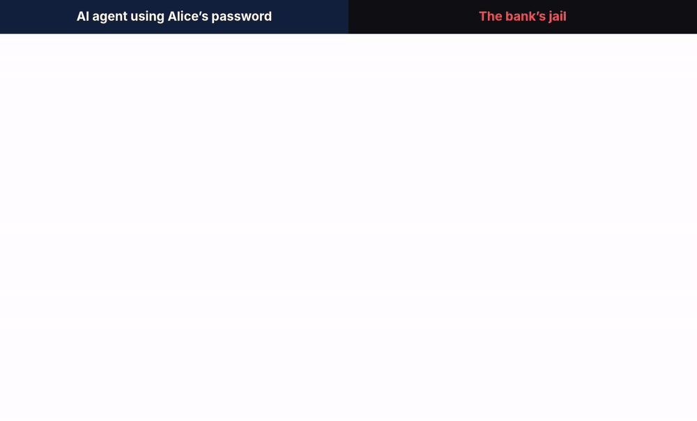
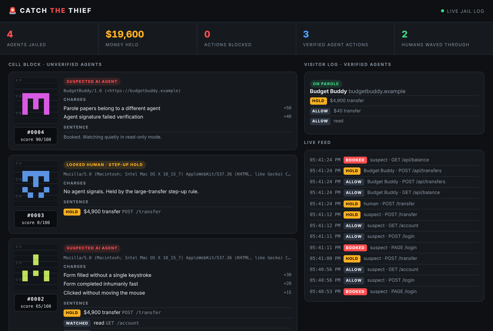

<div align="center">

# 🚨 catch-the-thief

**AI agents are logging into bank accounts with customers' passwords, and banks can't tell who sent them.**<br>
**This is a jail for them.**

Identify unknown agents · contain them instead of trusting them · give the good ones a legal way in

[](https://github.com/SaurabhManmode/catch-the-thief/actions/workflows/ci.yml)




</div>

## The problem

In October 2026, [major US banks reported](https://decrypt.co/381602/banks-rogue-ai-agents-inside-customer-accounts) third-party AI agents operating **inside customer accounts**. They signed in with the customer's own credentials and sometimes went beyond what the customer asked for. JPMorgan, Bank of America and Citi have [restricted outside agents](https://financefeeds.com/morgan-stanley-bofa-and-jpmorgan-flag-unauthorized-ai-agents-inside-customer-accounts/). The industry's stated problem is that they can't tell whether an agent *"was authorized by the customer or has gone rogue."*

Blocking every agent fails, because customers want agents. Trusting every login fails too, because that's how the thief gets in.

## The idea: identify → jail → parole

You will never detect every agent. A careful one driving a real browser looks human. So catch-the-thief doesn't bet everything on detection. It flips the default: **a session that hasn't proved who it is gets low privilege.**

| Session | How it's recognised | Read | Change things | Move money |
|---|---|---|---|---|
| 🧑 **Human** | no automation signals | ✅ | ✅ | ✅ (large amounts: step-up) |
| 🤔 **Uncertain** | some signals (score 25–49) | ✅ | ✅ | ⏸ held for the customer |
| 🚨 **Suspect** | strong signals (score ≥ 50) | 👀 read-only, slowed down | ⛔ | ⏸ held for the customer |
| 🪪 **Verified agent** | valid [Web Bot Auth](#for-agent-builders-get-paroled) signature | ✅ | ⛔ | ⏸ held for the customer |
| 🟢 **On parole** | verified **and** carrying the customer's signed consent | per scope | per scope | ✅ up to the customer's limit |

Nothing gets kicked out by default. Unknown agents land in a **jail**: they can look but not touch, every move is logged, and money waits for the real account holder. Every response tells the agent, in a machine-readable header, how to get out legitimately:

```
Agent-Jail: hold; class=suspect; reason="Suspected AI agent: money movement held until the account holder approves"; parole="/agents"
```

**Parole** is the legal way in. The customer grants an agent signed, scoped permission ("read balances, send up to $100") that's bound to that agent's cryptographic key. **The agent never needs the customer's password**, and stolen papers are useless without the key.

## Try it in 60 seconds

```bash
git clone https://github.com/SaurabhManmode/catch-the-thief && cd catch-the-thief
pip install -e ".[demo]" && playwright install chromium

uvicorn demo.bank:app --port 8000          # Bank of Nowhere (fictional) + jail at /jail
```

Open <http://localhost:8000/jail/> in one window, then in a terminal:

```bash
python -m demo.thief                  # headless agent with Alice's password tries to send $4,900
python -m demo.thief --disguise 1     # spoofed user agent, webdriver flag hidden
python -m demo.thief --disguise 2     # ...and types slowly, wiggles the mouse like a person
python -m demo.good_agent             # Budget Buddy: signed requests + Alice's parole papers
python -m demo.good_agent --stolen    # impostor with Budget Buddy's papers but the wrong key
```

What happens (these outcomes are re-checked in a real browser on every push):

| Attacker | Detected? | Score | $4,900 transfer |
|---|---|---|---|
| Plain headless agent | 🚨 yes | 100 | ⏸ held |
| Disguise 1: real Chrome UA, `webdriver` hidden | 🚨 yes | 65 | ⏸ held |
| Disguise 2: also types and moves the mouse like a person | ❌ **no** | 0 | ⏸ held by the step-up rule |
| Impostor with stolen parole papers | 🚨 yes | 90 | ⛔ no access at all |
| Budget Buddy on parole ($100 limit) | 🪪 verified | n/a | $40 ✅ sent · $4,900 ⏸ held |

Disguise 2 beats the detector, and that's the point of the design. **Detection is the first layer, not the last.** Money still didn't move.



## Add it to your app

```python
from fastapi import FastAPI, Request
from fastapi.responses import JSONResponse
from catch_the_thief import Thief, KeyDirectory

agents = KeyDirectory()
agents.load_file("trusted-agents.jwks.json")        # agents you recognise

ctt = Thief(secret="...", agents=agents, db="jail.db", parole_url="/agents",
            confirm_over=2500)                       # step-up for big transfers from anyone unverified

app = FastAPI()
app.add_middleware(ctt.Middleware)                   # classifies every request, tarpits suspects
app.mount("/jail", ctt.dashboard())                  # put this behind your staff auth!

@app.post("/transfers")
async def transfer(request: Request, body: TransferIn):    # TransferIn: your pydantic model
    d = ctt.decide(request, "money", amount=body.amount)
    if d.allowed:
        send_money(body)
    elif d.held:
        queue_for_customer_approval(body, reason=d.reason)   # confirm out-of-band (push, SMS)
    return JSONResponse(d.as_dict(), d.status_code, headers=d.headers())
```

Add one line to your HTML pages so in-page signals are collected:

```html
<script src="/_ctt/beacon.js" defer></script>
```

Actions are `read`, `write`, `money` and `human_only` (approving holds, granting parole, changing passwords). The whole policy table is a dict you can override:

```python
Thief(secret="...", policy={"suspect": {"read": "deny"}})   # stricter: suspects can't even look
```

## For agent builders: get paroled

If you build an agent, don't scrape logins. Sign your requests with [Web Bot Auth](https://datatracker.ietf.org/doc/draft-meunier-web-bot-auth-architecture/) (HTTP Message Signatures, RFC 9421, Ed25519) and carry the customer's consent:

```python
from catch_the_thief import sign_request

headers = sign_request(my_key, authority="bank.example", signature_agent="https://myagent.example",
                       method="POST", path="/api/transfers")
headers["Agent-Consent"] = papers_the_customer_granted_me
httpx.post("https://bank.example/api/transfers", headers=headers, json={...})
```

Publish your public key as a JWKS (see [`demo/agents/budget-buddy.jwks.json`](demo/agents/budget-buddy.jwks.json)) so sites can add you to their key directory.

## What it looks for

Each signal adds to a 0–100 score. None is proof on its own.

| Layer | Signals |
|---|---|
| **Identity** | Web Bot Auth signature valid / forged / expired / unknown key · consent papers forged, revoked, or bound to a different agent |
| **Headers** | automation user agents (HeadlessChrome, Playwright, Selenium) · scripted clients (curl, python-requests, Go, axios…) · self-declared AI agents (ChatGPT-User, Claude-User, PerplexityBot…) · headless client hints · browsers missing Accept-Language, client hints or Fetch Metadata |
| **In-page beacon** | `navigator.webdriver` · headless tells · DevTools protocol attached · forms filled without a single keystroke · forms completed inhumanly fast · clicks without mouse movement · synthetic events |
| **Behaviour** | machine-regular request timing · bursts faster than a person can click · acting without ever running the page's JavaScript |

The beacon sends **counts and timings only**: never keystrokes, field values or anything personal.

## Honest limits

- **Detection is an arms race.** A determined agent in a real, carefully driven browser can pass as human (see disguise 2). That's why money from *any* unverified session can be held above a threshold (`confirm_over`), and why holds must be approved **out-of-band** (push notification, phone). In the demo the approve button sits on the same page for simplicity.
- **False positives happen.** Password managers fill forms without keystrokes, and accessibility tools can look automated. That's why the default jail never locks anyone out of reading: it only holds money for confirmation. Tune thresholds against your own traffic before enforcing.
- **Single process.** Session state lives in memory and the jail log in SQLite. Use a shared store (Redis) for multiple workers.
- **Partial Web Bot Auth.** Implemented: Ed25519, `@authority`/`@method`/`@path`/`@query` and header components, `created`/`expires` checks. Not yet: nonce replay protection, fetching remote key directories, the dictionary form of `Signature-Agent`.
- This is an open-source reference implementation, **not a certified fraud system**. Bank of Nowhere is fictional, and this project isn't affiliated with any bank.

## Roadmap

- [ ] Express / Hono middleware (same policy model, TypeScript)
- [ ] Redis session store and Postgres jail log
- [ ] Nonce replay protection + remote key-directory fetching for Web Bot Auth
- [ ] Guard for MCP servers (jail unknown agents calling your tools)
- [ ] OpenTelemetry export of bookings
- [ ] Out-of-band approval adapters (web push, Twilio)

PRs welcome, especially new signals with a test showing the false-positive rate.

## Run the tests

```bash
pip install -e ".[test]"
python -m unittest discover -s tests -v
```

## License

MIT · Built by [Saurabh Manmode](https://github.com/SaurabhManmode). If it caught something for you, a ⭐ helps others find it.
